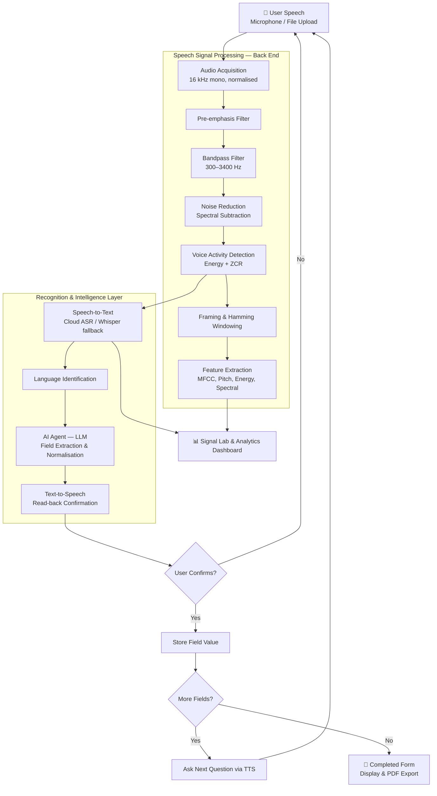

# 🎙️ VaakSetu — Multilingual Voice Form Filler

> **Speak your details, in your language. VaakSetu fills the form for you.**

VaakSetu (*Vaak* = speech, *Setu* = bridge) is a speech signal processing application that lets users fill out public-service forms — hospital registrations, scheme applications, admission forms — simply by speaking in **Malayalam, Kannada, Hindi, or English**. It combines a classical speech preprocessing pipeline with modern multilingual speech recognition, an AI agent for information extraction, and text-to-speech confirmation.

**Course:** Speech Processing — CIA Component III (Mini Project)
**Programme:** MSc Artificial Intelligence and Machine Learning, CHRIST (Deemed to be University), Bengaluru

---

## 📑 Table of Contents

1. [Problem Statement](#-problem-statement)
2. [Proposed Solution](#-proposed-solution)
3. [Key Features](#-key-features)
4. [System Architecture](#-system-architecture)
5. [Implementation Pipeline](#-implementation-pipeline)
6. [Signal Processing Techniques](#-signal-processing-techniques)
7. [Features Extracted](#-features-extracted)
8. [Models and APIs](#-models-and-apis)
9. [Visualization and Analytics](#-visualization-and-analytics)
10. [Evaluation Methodology](#-evaluation-methodology)
11. [Project Structure](#-project-structure)
12. [Installation and Usage](#-installation-and-usage)
13. [Team and Responsibilities](#-team-and-responsibilities)
14. [Limitations](#-limitations)
15. [Future Scope](#-future-scope)

---

## ❗ Problem Statement

Access to public services in India still depends heavily on **written forms**. Hospital registrations, government welfare schemes, bank applications, and admission processes all assume the applicant can read and write — often in English or the state's administrative language.

This creates real barriers for:

- People with **limited literacy**, especially in rural and semi-urban areas
- **Elderly citizens** who struggle with small text and digital interfaces
- People with **visual or motor impairments** who cannot easily write or type
- **Migrant workers** who may not read the local language of the state they live in

Existing voice assistants rarely handle **regional Indian languages**, **code-mixed speech** (e.g. Malayalam mixed with English), or the **noisy environments** of hospitals, ration shops, and service counters. As a result, many people depend on intermediaries to fill forms, which costs time, money, and privacy.

---

## 💡 Proposed Solution

VaakSetu replaces the written form with a **guided voice conversation**:

1. The app **asks each question aloud** in the user's chosen language ("Please tell me your name").
2. The user **answers by speaking**.
3. The audio is **cleaned** using a speech signal processing pipeline designed for noisy, phone-quality input.
4. A **multilingual speech recognition model** transcribes the answer.
5. An **AI agent** extracts and normalises the required field (names, ages, dates, phone numbers, addresses).
6. The extracted value is **read back** using text-to-speech, and the user confirms or corrects it.
7. Once all fields are confirmed, the **completed form** is displayed and can be exported.

Asking for **one field at a time** keeps recognition accurate, makes extraction reliable, and gives the user a chance to correct mistakes immediately.

---

## ✨ Key Features

| Feature | Description |
|---|---|
| 🌐 **Multilingual input** | Malayalam, Kannada, Hindi, and English, including code-mixed speech |
| 🧹 **Noise-robust preprocessing** | Pre-emphasis, bandpass filtering, noise reduction, and voice activity detection |
| 🗣️ **Guided voice dialogue** | Field-by-field questions spoken in the user's language |
| 🤖 **AI field extraction** | LLM agent converts spoken answers into clean structured values |
| 🔁 **Read-back confirmation** | Every answer is spoken back so the user can confirm or correct it |
| 📴 **Offline fallback** | Local Whisper model takes over if the internet connection fails |
| 🔬 **Signal Lab** | Live waveform, spectrogram, MFCC, and pitch plots — before and after preprocessing |
| 📊 **Analytics dashboard** | Word error rate vs. noise level, session logs, language statistics |
| 📄 **Form export** | Completed form shown on screen and exportable as PDF |

---

## 🏗️ System Architecture



### Layered view

| Layer | Responsibility | Module |
|---|---|---|
| **Acquisition** | Capture and standardise audio | `preprocess.py` |
| **Signal Processing** | Clean the audio and extract features | `preprocess.py`, `features.py` |
| **Recognition** | Transcribe speech and identify language | `asr_agent.py` |
| **Intelligence** | Extract and normalise form fields | `asr_agent.py` |
| **Synthesis** | Speak questions and read-back confirmations | `asr_agent.py` |
| **Presentation** | Dialogue UI, visualisations, analytics | `app.py`, `visualize.py` |

---

## 🔄 Implementation Pipeline

### Stage 1 — Speech Acquisition
- Audio is recorded from the microphone through the Streamlit interface, or uploaded as a `.wav` / `.mp3` file.
- All audio is converted to **16 kHz, mono, 16-bit** and amplitude-normalised to the range [−1, 1].

### Stage 2 — Preprocessing
1. **Pre-emphasis** boosts high frequencies that carry consonant information.
2. **Bandpass filtering (300–3400 Hz)** removes low-frequency hum and high-frequency hiss outside the main speech band.
3. **Noise reduction** estimates the noise spectrum from non-speech segments and subtracts it.
4. **Voice activity detection** removes leading, trailing, and long internal silences.

### Stage 3 — Feature Extraction
- The signal is split into **25 ms frames with a 10 ms hop**, each multiplied by a **Hamming window**.
- Time-domain, frequency-domain, and cepstral features are computed (see [Features Extracted](#-features-extracted)).
- Features drive the visualisations and support analysis of how preprocessing changes the signal.

### Stage 4 — Speech Recognition
- The cleaned audio is sent to the **primary speech-to-text API**.
- If the API is unavailable, the **local Whisper model** is used instead.
- The recogniser returns the **transcript** and the **detected language**.

### Stage 5 — AI Field Extraction
- The transcript, the target field name, and the expected format are passed to an **LLM agent**.
- The agent returns a clean, normalised value — for example:
  - *"ente peru Athira Mohan aanu"* → `Name: Athira Mohan`
  - *"irupathi anju vayassu"* → `Age: 25`
  - *"fifteenth March two thousand"* → `Date of Birth: 15-03-2000`

### Stage 6 — Confirmation Loop
- The extracted value is **spoken back** in the user's language using text-to-speech.
- The user says *"yes / correct"* to accept or *"no / say again"* to repeat the field.

### Stage 7 — Output
- After all fields are confirmed, the completed form is shown on screen and can be **exported as a PDF**.
- Session data (language, attempts per field, confidence) is logged for the analytics dashboard.

---

## 🔬 Signal Processing Techniques

| Technique | Purpose | Formula / Method |
|---|---|---|
| **Resampling** | Standardise input to the rate expected by ASR models | 16 kHz using polyphase resampling |
| **Pre-emphasis** | Boost high-frequency energy, balance the spectrum | y[n] = x[n] − α·x[n−1], α = 0.97 |
| **Bandpass filter** | Keep the main speech band, remove hum and hiss | Butterworth filter, 300–3400 Hz |
| **Noise reduction** | Suppress stationary background noise | Spectral subtraction / spectral gating |
| **Voice activity detection** | Separate speech from silence | Short-time energy + zero-crossing rate thresholds |
| **Framing** | Treat speech as quasi-stationary over short intervals | 25 ms frames, 10 ms hop |
| **Windowing** | Reduce spectral leakage at frame edges | Hamming window: w[n] = 0.54 − 0.46·cos(2πn / (N−1)) |
| **Short-Time Fourier Transform** | Time–frequency representation | FFT of each windowed frame |

---

## 📐 Features Extracted

| Domain | Feature | What it captures |
|---|---|---|
| **Time** | Short-time energy | Loudness; used in voice activity detection |
| **Time** | Zero-crossing rate (ZCR) | Voiced vs. unvoiced sounds and noise |
| **Frequency** | Spectral centroid | "Brightness" of the sound |
| **Frequency** | Spectral rolloff and bandwidth | Spread of energy across frequencies |
| **Frequency** | Mel spectrogram | Energy on a perceptual (mel) frequency scale |
| **Cepstral** | MFCCs (13) with Δ and ΔΔ | Vocal tract shape; the standard ASR feature |
| **Prosodic** | Pitch (F0) using pYIN | Intonation and speaker voice characteristics |

### MFCC computation steps
1. Pre-emphasis → framing → Hamming windowing
2. FFT → power spectrum
3. Mel filterbank (26 triangular filters)
4. Logarithm of filterbank energies
5. Discrete Cosine Transform → first 13 coefficients
6. Delta and delta-delta coefficients for temporal dynamics

---

## 🧠 Models and APIs

| Component | Model / API | Role | Mode |
|---|---|---|---|
| **Speech-to-Text (primary)** | Cloud multilingual ASR (configurable: Google Cloud Speech-to-Text / Sarvam AI / hosted Whisper large-v3) | High-accuracy transcription for Indian languages | Online |
| **Speech-to-Text (fallback)** | OpenAI Whisper `small` | Offline transcription when internet is unavailable | Local, CPU |
| **Language Identification** | Whisper built-in language detection | Detect which language the user is speaking | Local / Online |
| **AI Agent** | LLM via API (e.g. Google Gemini) | Extract and normalise field values from transcripts | Online |
| **Text-to-Speech** | gTTS | Speak questions and read-back confirmations in en / hi / ml / kn | Online |
| **Noise Reduction** | `noisereduce` (spectral gating) | Suppress background noise | Local |
| **Pitch Estimation** | pYIN (`librosa`) | Fundamental frequency tracking | Local |

### Why Whisper?
Whisper is an **encoder–decoder Transformer** trained on large-scale multilingual audio. It takes a **log-mel spectrogram** as input, supports all four target languages, performs language identification, and handles code-mixed speech reasonably well — making it a strong offline fallback.

### Why an LLM agent instead of rule-based parsing?
Spoken answers are unpredictable: numbers may be spoken in Malayalam or English, dates come in many formats, and names may be embedded in full sentences. An LLM handles this variation far more reliably than hand-written rules, and its output is constrained to a strict JSON format for each field.

---

## 📊 Visualization and Analytics

### Signal Lab (per recording)
- Raw vs. preprocessed **waveform**
- Raw vs. preprocessed **spectrogram**
- **Mel spectrogram** and **MFCC heatmap**
- **Pitch contour** with energy overlay
- **Voice activity detection** segmentation plot

### Analytics Dashboard
- **Word error rate vs. SNR** — with and without preprocessing
- Recognition accuracy **by language**
- Number of **attempts per field** (how often users needed to correct answers)
- Session history and completed-form log

---

## 🧪 Evaluation Methodology

### Test dataset
- 20–30 short clips recorded by the team across all four languages, covering names, ages, dates, phone numbers, and addresses.
- Each clip has a manually written **reference transcript**.

### Noise robustness experiment
- Background noise is added to each clip at **20 dB, 10 dB, and 5 dB SNR**.
- Each noisy clip is transcribed **with** and **without** the preprocessing pipeline.

### Metrics

| Metric | Definition |
|---|---|
| **Word Error Rate (WER)** | WER = (S + D + I) / N, where S = substitutions, D = deletions, I = insertions, N = words in reference |
| **Field Extraction Accuracy** | % of fields where the extracted value exactly matches the expected value |
| **First-attempt Success Rate** | % of fields confirmed without needing a correction |

### Results

> 📝 *To be filled after experiments.*

| SNR | WER (no preprocessing) | WER (with preprocessing) |
|---|---|---|
| Clean | — | — |
| 20 dB | — | — |
| 10 dB | — | — |
| 5 dB | — | — |

---

## 📁 Project Structure

```
vaaksetu/
├── app.py                  # Streamlit app — dialogue, Signal Lab, Analytics tabs
├── preprocess.py           # Acquisition + preprocessing (clean_audio)
├── features.py             # Feature extraction (MFCC, pitch, energy, ZCR, spectral)
├── visualize.py            # Waveform, spectrogram, MFCC, pitch, VAD plots
├── asr_agent.py            # transcribe(), extract_field(), speak()
├── evaluate.py             # Noise injection + WER experiment
├── forms/
│   └── hospital_registration.json   # Form field definitions and prompts
├── data/
│   ├── test_clips/         # Recorded evaluation clips
│   └── references.csv      # Reference transcripts
├── outputs/
│   ├── forms/              # Exported completed forms (PDF)
│   └── plots/              # Saved visualisations and WER charts
├── assets/
│   └── architecture.png    # Architecture diagram
├── requirements.txt
├── .env.example            # API key template
└── README.md
```

### Module interfaces

| Function | Module | Input | Output |
|---|---|---|---|
| `clean_audio()` | `preprocess.py` | Raw audio, sample rate | Cleaned 16 kHz audio |
| `extract_features()` | `features.py` | Audio | Dictionary of feature arrays |
| `transcribe()` | `asr_agent.py` | Cleaned audio | Transcript, detected language |
| `extract_field()` | `asr_agent.py` | Transcript, field name | Normalised field value |
| `speak()` | `asr_agent.py` | Text, language | Audio for playback |

---

## ⚙️ Installation and Usage

### Requirements
- Python 3.10+
- 8 GB RAM (no GPU required)
- Microphone
- Internet connection for cloud ASR, LLM, and TTS (offline fallback available for ASR)

### Setup

```bash
# Clone the repository
git clone <repository-url>
cd vaaksetu

# Create and activate a virtual environment
python -m venv venv
source venv/bin/activate        # Windows: venv\Scripts\activate

# Install dependencies
pip install -r requirements.txt

# Add API keys
cp .env.example .env            # then edit .env with your keys
```

### Run the app

```bash
streamlit run app.py
```

### Run the evaluation experiment

```bash
python evaluate.py --clips data/test_clips --refs data/references.csv
```

### Core dependencies

```
streamlit
librosa
numpy
scipy
soundfile
noisereduce
openai-whisper
gTTS
jiwer
matplotlib
plotly
python-dotenv
fpdf2
```

---

## 👥 Team and Responsibilities

| Member | Role | Owns |
|---|---|---|
| **Member 1** — *[Name]* | Speech Signal Processing | Acquisition, preprocessing, feature extraction, Signal Lab plots, noise-robustness experiment |
| **Member 2** — *[Name]* | Recognition and AI | Speech-to-text, language identification, LLM field extraction, text-to-speech, WER computation |
| **Member 3** — *[Name]* | Application and Integration | Streamlit app, dialogue flow, module integration, form export, architecture diagram, documentation, demo |

---

## ⚠️ Limitations

- Recognition accuracy for **Malayalam and Kannada** is lower than for English and Hindi, especially with the offline model.
- **Rare names and place names** may be mistranscribed; the read-back loop mitigates but does not eliminate this.
- Cloud ASR, LLM, and TTS require an **internet connection**; only ASR has an offline fallback.
- Spectral subtraction works best on **stationary noise** (fans, hum) and less well on babble or music.
- The evaluation set is small and recorded by the team, so results indicate trends rather than general performance.

---

## 🚀 Future Scope

- Fine-tune ASR on Indian-language datasets for better regional accuracy
- Add more languages (Tamil, Telugu, Bengali)
- Speaker verification so returning users can retrieve saved forms by voice
- Fully offline mode with on-device LLM and TTS for low-connectivity areas
- Integration with real service portals (hospital management systems, government scheme portals)
- Kiosk deployment for hospitals, panchayat offices, and service centres

---

## 🙏 Acknowledgements

Developed as part of the **Speech Processing** course (CIA Component III), MSc Artificial Intelligence and Machine Learning, **CHRIST (Deemed to be University), Bengaluru**.

Built with open-source tools including OpenAI Whisper, librosa, noisereduce, gTTS, and Streamlit.
