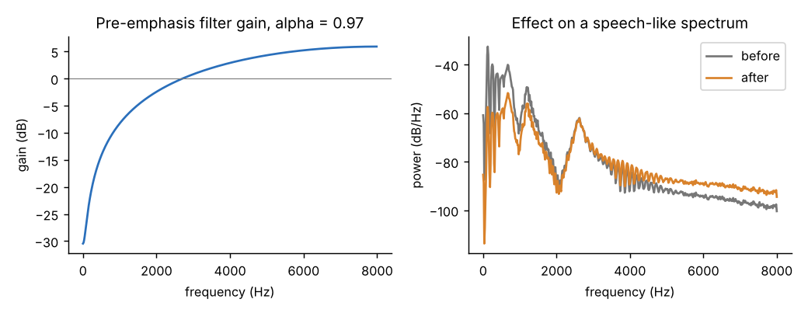
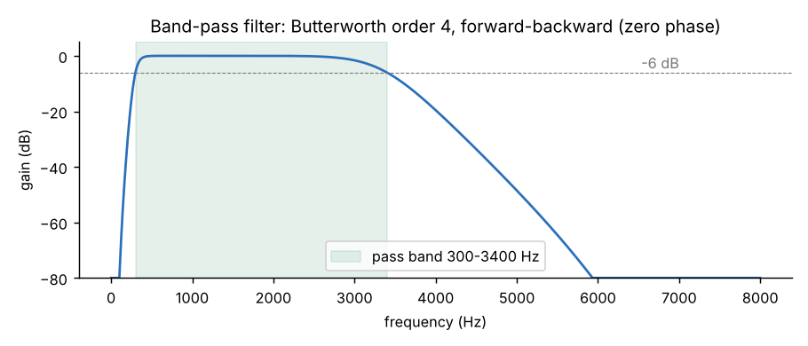
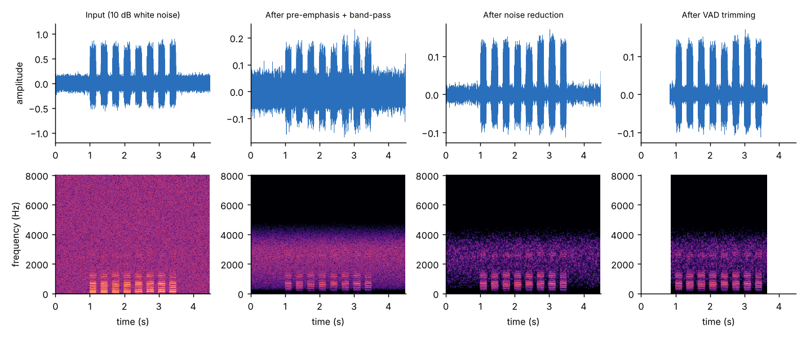
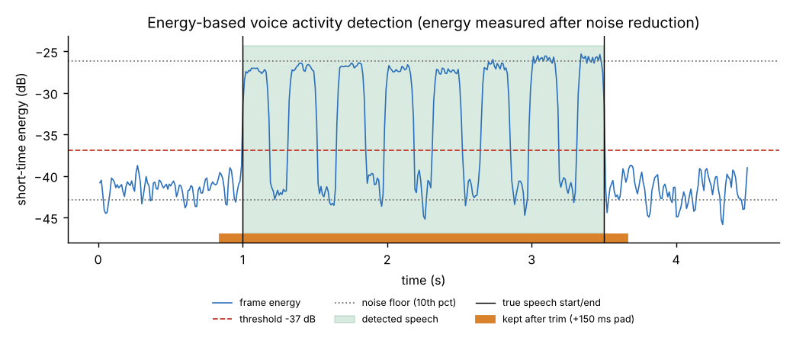
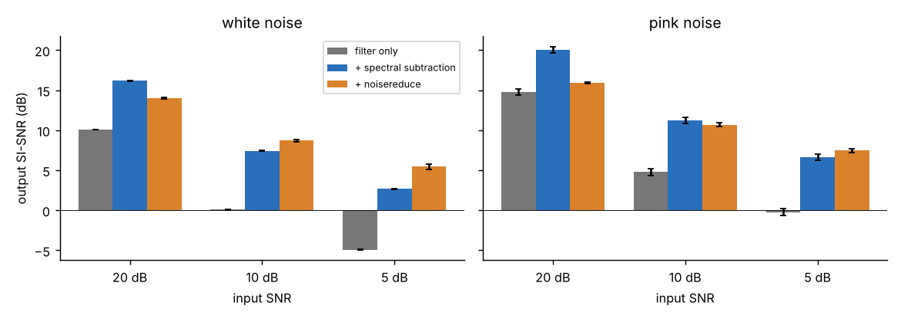

# 1. What 1B is and what it promises

1B takes the clean, standard audio produced by sub-module 1A (mono, 16 kHz, peak-normalised) and prepares it for the speech-recognition model. It applies four signal-processing stages and a final level adjustment:

```
1A output ─► PRE-EMPHASIS ─► BAND-PASS ─► NOISE REDUCTION ─► VAD TRIMMING ─► RE-NORMALISE ─► cleaned audio
             (tilt up)      300–3400 Hz   (spectral          (cut leading/    (peak 0.9)
                                           subtraction)       trailing silence)
```

> **`cleaned = clean_audio(source)`** → 1-D `float32` NumPy array, mono, 16 000 Hz, peak 0.9, values in [-1, 1].

`source` can be anything 1A understands (file path, bytes, Streamlit upload, `(signal, sr)` tuple) or simply the array that `load_audio` returned (a bare array is assumed to be 16 kHz). This means Member 2 only needs `transcribe(clean_audio(x))`.

| Item | Value |
|---|---|
| Module file | `preprocess.py` (depends only on `audio_io.py` from 1A, NumPy and SciPy; `noisereduce` is optional) |
| Main functions | `clean_audio`, `clean_audio_with_stages`, `pre_emphasis`, `bandpass_filter`, `spectral_subtraction`, `reduce_noise`, `detect_speech`, `trim_silence` |
| Configuration | `PreprocessConfig`: every stage can be switched off or tuned (needed for the 1C "with vs without preprocessing" experiment) |
| Tests | 51 new tests (`tests/test_preprocess.py`), all passing; 122 in total with 1A |
| Speed | about 13 ms for a 4.5 s clip (≈ 0.3 % of real time) |
| Command line | `python preprocess.py in.wav out.wav` prints a short report |

# 2. Everything that was used

| Component | Version | Role in 1B |
|---|---|---|
| Python | 3.13 | Language |
| **NumPy** | 2.5.3 | Arrays, percentiles, energy computation |
| **SciPy** | 1.18.1 | `signal.butter` / `sosfiltfilt` (band-pass), `signal.stft` / `istft` (spectral subtraction), `freqz` (filter plots), `ndimage.uniform_filter1d` (gain smoothing) |
| **noisereduce** (optional) | 3.0.3 | Alternative noise-reduction back end (`denoise="noisereduce"`) |
| `audio_io.py` (1A) | — | Loading, mono, 16 kHz, normalisation (`load_audio_with_report`, `normalize_amplitude`) |
| pytest, Matplotlib | 9.2.0 / 3.11.2 | Tests and figures |

The VAD, the spectral subtraction and the filters are **implemented directly from the algorithms**, not taken from a VAD package, so every step can be explained in the viva.

## Dataset

Like 1A, 1B does not learn from data, so **there is no training dataset**. It is tuned and checked on test material with a known ground truth:

* **Synthetic speech-like signal** (from `scripts/synth.py`): a glottal-pulse source with gliding pitch (110→140 Hz) through three formant resonators (700/1200/2600 Hz), gated into syllable-rate bursts with short pauses. It is **not real speech**, but its true clean waveform and its true start/end times are known exactly.
* **Synthetic noise**: *white* noise (flat spectrum, like hiss) and *pink* noise (power ∝ 1/f, like room rumble and fans), mixed in at **20, 10 and 5 dB SNR**, the same three levels the evaluation experiment (1C) uses. SNR is measured against the power of the *active* speech. Each clip is 1 s background, 2.5 s speech, 1 s background.
* Files are in `sample_audio/noisy/` (`white_20dB.wav` … `pink_5dB.wav` and `clean_reference.wav`), created by `scripts/make_noisy_samples.py`.
* **Real recordings** are still needed for the final demo and for the real WER experiment: the team's own recordings of form answers (and optionally Common Voice / FLEURS) in Malayalam, Kannada, Hindi and English. 1B works unchanged on them.

*Honest limitation:* every number in this document comes from synthetic speech and synthetic noise. It shows that the algorithms behave correctly, but **real voices and real room noise must still be tried** before claiming a result.

# 3. How each stage works

## Step 0 — Input
`clean_audio` first calls 1A's `load_audio_with_report`, so any input becomes mono / 16 kHz / normalised, and any 1A error (missing file, NaN, too long…) appears unchanged. 1A's warnings (clipping, very quiet) are copied into the 1B report. Settings are checked (`PreprocessConfig.validate`) and a wrong value raises `ValueError`.

## Step 1 — Pre-emphasis
**Formula:** `y[n] = x[n] − 0.97 · x[n−1]` (with `y[0] = x[0]`).

**Why?** Voiced speech has most of its energy in the low harmonics, and the spectrum falls by about 6–12 dB per octave. The weak but information-rich high-frequency parts (the hiss of *s*, *sh*, *f*, the bursts of *t*, *k*, *p*) end up tiny compared with the vowels. Pre-emphasis is a first-order **high-pass tilt** that boosts high frequencies and suppresses low ones, which flattens the spectrum. It also compensates for the roll-off caused by the way the glottal pulse and lips radiate sound, and it makes later numerical processing less dominated by the loud low frequencies.

**Gain of the filter** (α = 0.97; `|H(f)|² = 1 + α² − 2α cos(2πf/fs)`):

| Frequency | 0 Hz | 100 Hz | 500 Hz | 1 kHz | 2 kHz | 2.7 kHz | 4 kHz | 8 kHz |
|---|---|---|---|---|---|---|---|---|
| Gain | −30.5 dB | −26.2 dB | −14.2 dB | −8.3 dB | −2.4 dB | 0 dB | +2.9 dB | +5.9 dB |

The filter removes the DC component and low rumble almost completely and gives about 6 dB of boost at the top. α is chosen close to 1 (0.95–0.97 is the standard range) so the corner is low and the boost is gentle.

{width=16cm}

## Step 2 — Band-pass filter, 300–3400 Hz
**Design:** Butterworth, order 4 per edge (so 8 poles in total), designed with `scipy.signal.butter(..., output="sos")`, applied with **`sosfiltfilt`** (forward then backward).

* *Why 300–3400 Hz?* This is the classic telephone speech band. It contains the first three vowel formants and most consonant information, and removes mains hum (50 Hz and its harmonics), handling and wind rumble below 300 Hz, and microphone hiss above 3.4 kHz.
* *Why Butterworth?* It has the **maximally flat pass band** (no ripple), so the voice is not coloured. Its price is a gentler roll-off than Chebyshev or elliptic filters, which is acceptable here.
* *Why second-order sections (SOS)?* A narrow band-pass written as one high-order polynomial is numerically unstable; splitting it into cascaded biquads is stable.
* *Why forward-backward (zero phase)?* A normal IIR filter delays frequencies by different amounts (phase distortion) and shifts the timing. Filtering forward, reversing, filtering again and reversing again cancels the phase completely, so **nothing is delayed** and the VAD times map directly onto the original recording. A side effect is that the magnitude is squared: the edges, normally −3 dB, become **−6 dB**. This is possible because we process a *recorded* clip offline; a live system would need a causal filter.

**Measured gain** (tones of 0.5 amplitude passed through the real filter):

| Frequency | 50 Hz | 100 Hz | 200 Hz | 300 Hz | 400 Hz | 500 Hz | 1–2 kHz | 3 kHz | 3.4 kHz | 4 kHz | 6 kHz |
|---|---|---|---|---|---|---|---|---|---|---|---|
| Gain | −130 dB | −81 dB | −31.5 dB | −6.0 dB | −0.5 dB | 0 dB | 0 dB | −1.6 dB | −6.0 dB | −19.6 dB | −83 dB |

The theoretical response (SciPy `sosfreqz`, squared) agrees with the measurement; both are checked in the tests.

{width=15cm}

## Step 3 — Noise reduction (spectral subtraction)
Two methods are available through `denoise=`; the built-in **spectral subtraction** is the default.

**Idea.** Noise adds power to every frequency bin. If we know how much power the noise has in each bin, we can subtract it and keep the rest. The noise spectrum is not known in advance, so it is estimated from the recording itself.

**Algorithm (implemented in `spectral_subtraction`):**

1. **STFT.** Split the signal into 32 ms frames (512 samples), advance 8 ms (128 samples, 75 % overlap), multiply each frame by a Hann window and take the FFT. Result: `X(t, f)`, a spectrum per frame. Hann windows with 75 % overlap sum to a constant, so the signal is rebuilt perfectly by overlap-add.
2. **Noise estimate.** Compute each frame's total energy and take the quietest 20 % of frames (the pauses before and after the words). The average power spectrum of those frames is the noise estimate `N(f)`. No separate "silence recording" is needed.
3. **Gain per time-frequency bin** (Boll's subtraction with Berouti's over-subtraction):

    `G(t,f)² = max( 1 − α · N(f) / |X(t,f)|² ,  floor² )`, with α = 2 and floor = 0.1 (−20 dB).

    Bins where the noise dominates get a gain near the floor; bins where speech dominates keep a gain near 1. *Over-subtraction* (α = 2 > 1) removes the random fluctuation of noise peaks; the *floor* stops bins from being cut to zero, which would produce harsh gaps.
4. **Smoothing.** The gain is averaged over 3 frames. Isolated bins that randomly cross the threshold produce short chirps known as **"musical noise"**; smoothing reduces them.
5. **Reconstruction.** Apply the gain to the *complex* STFT (the noisy phase is reused, which is acceptable above about 6 dB SNR), then inverse STFT and overlap-add. The output has exactly the same length as the input.

**When it declines to act.** If the loudest and quietest frames differ by less than 3 dB (no pauses, or continuous noise), the noise level cannot be estimated, so the audio is returned unchanged and the report says *"Noise reduction skipped: no clear pauses…"*. This protects speech from being eaten when someone speaks without a pause.

**`noisereduce` back end.** `denoise="noisereduce"` calls `noisereduce.reduce_noise(stationary=True)`, an established spectral-gating implementation. If the package is not installed a clear error explains how to install it.

{width=17cm}

## Step 4 — Voice activity detection (VAD) and trimming
**Why trim?** Speech recognisers hallucinate or waste time on long stretches of silence/noise, and the form dialogue must not feed 3 s of background into every answer.

**How the VAD works (`detect_speech`, all implemented from scratch):**

1. **Frame energy.** Cut the signal into 25 ms frames every 10 ms and compute each frame's mean-square energy in dB (done in O(n) with a cumulative sum).
2. **Adaptive threshold.** Take the 10th percentile of the energies as the *background level* and the 95th percentile as the *speech level*. The threshold lies 30 % of the way from background to speech, but at least 6 dB above the background (or half the contrast if the contrast is under 12 dB). Because it is relative, it works for loud and quiet recordings alike (tested: scaling the input by 0.1 shifts the threshold by exactly 20 dB and gives the same segments).
3. **Decision.** A frame is speech if its energy exceeds the threshold.
4. **Hangover / smoothing.** Bursts shorter than 80 ms (clicks, pops) are discarded; silences shorter than 300 ms *between* speech frames are bridged, so gaps between words or stop consonants do not split an utterance.
5. **Trim.** The recording is cut from the first speech frame to the last, with a **150 ms safety margin** on each side (so soft word beginnings and endings are kept). **Pauses inside the utterance are kept**, because removing them would change how digits and names are spoken.
6. **Honest fall-backs.** If the contrast between speech and background is under 3 dB, the VAD cannot decide: the clip is left untrimmed and the report warns *"Could not separate speech from background noise"*. If it is reliable but finds nothing, the report says *"No speech detected; please repeat."* (the app can then ask the user again).

{width=15cm}

## Step 5 — Re-normalise
Filtering and noise reduction change the loudness, so the final signal is peak-normalised to 0.9 again (reusing 1A's `normalize_amplitude`). Silence is never amplified.

## The report and the stage signals (for 1C and the Signal Lab)
`clean_audio_with_stages` returns a `PreprocessResult` with:

* `signal`: the final audio.
* `stages`: `input`, `pre_emphasis`, `bandpass`, `denoised` (all with the same length and time axis), and `trimmed`.
* `vad`: frame times, energy, threshold, speech mask, segments, reliability flag. Plot-ready.
* `trim_start`, `trim_end`: sample positions of the cut.
* `report`: stages applied, durations, how much was trimmed, noise floor before/after (dB), whether speech was detected, and warnings.

`pre_emphasis_response()` and `bandpass_response()` return filter curves for plotting.

# 4. Using it

```python
from audio_io import load_audio
from preprocess import clean_audio, clean_audio_with_stages, PreprocessConfig

cleaned = clean_audio("answer.wav")                 # the 1B contract
cleaned = clean_audio(uploaded_file)                # Streamlit upload / st.audio_input
signal, sr = load_audio("answer.wav"); cleaned = clean_audio(signal)   # chaining 1A -> 1B

# For the Signal Lab plots:
res = clean_audio_with_stages("answer.wav")
res.stages["input"], res.stages["denoised"], res.vad.mask, res.report.warnings

# For the 1C experiment (with / without / ablations):
raw      = clean_audio(f, pre_emphasis=None, bandpass=False, denoise=None, vad=False)
only_nr  = clean_audio(f, pre_emphasis=None, bandpass=False, vad=False)
nr_lib   = clean_audio(f, denoise="noisereduce")
```

# 5. Results (measured on synthetic speech + noise)

SI-SNR is the scale-invariant signal-to-noise ratio of the output against the known clean signal (higher is better; the clean signal is passed through the same filters so that only the noise is judged). Values are means over 5 noise seeds (standard deviations are at most 0.41 dB, shown in the chart).

| Noise | Input SNR | Filters only (dB) | + spectral subtraction (dB) | + noisereduce (dB) | VAD speech found | VAD boundary error |
|---|---|---|---|---|---|---|
| white | 20 dB | 10.1 | **16.2** | 14.0 | 5/5 | 18 ms |
| white | 10 dB | 0.1 | 7.4 | **8.7** | 5/5 | 13 ms |
| white | 5 dB | −4.9 | 2.7 | **5.4** | 5/5 | 12 ms |
| pink | 20 dB | 14.8 | **20.1** | 15.9 | 5/5 | 18 ms |
| pink | 10 dB | 4.8 | **11.2** | 10.7 | 5/5 | 15 ms |
| pink | 5 dB | −0.2 | 6.7 | **7.5** | 5/5 | 13 ms |

{width=16cm}

**How to read this**

* Noise reduction adds **about 6–8 dB** on top of filtering at 10 dB and 5 dB input SNR, and the background level falls by about 11 dB.
* The built-in spectral subtraction is better at 20 dB and for pink noise at 10 dB; `noisereduce` is better for white noise at 10 and 5 dB. Neither wins everywhere, so **`denoise` is a parameter** and 1C can compare both on real recordings.
* The "filters only" column already looks good because the *synthetic* speech has almost all its energy inside 300–3400 Hz while the white noise is spread to 8 kHz, so the band-pass discards most of the noise for free. **Real speech has useful energy above 3.4 kHz (fricatives), so the filter gain on real recordings will be smaller than shown here.**
* VAD start/end errors are 12–18 ms on average, well inside the 150 ms margin, so no speech is cut.

# 6. Testing

`python -m pytest tests/test_preprocess.py` runs 51 tests (about 4 s):

* **Pre-emphasis:** exact formula on known samples; gain rises monotonically with frequency; response equals the theoretical `√(1+α²−2α cos ω)` and +5.9 dB at 8 kHz; it reduces the spectral tilt of a −6 dB/octave signal by more than 15 dB.
* **Band-pass:** gain measured with tones at 50 Hz … 7.5 kHz (stop-band below −30 dB, pass band ≥ 0.95, edges −6 dB); zero-phase (no delay); formula agrees with measurement; short signals and upper edge above Nyquist handled.
* **Noise reduction:** SNR improves by more than 3 dB for white/pink noise at 20/10/5 dB; the noise floor drops by more than 6 dB; length and dtype preserved; speech energy preserved (0.85–1.05) on an almost clean clip; no action when there are no pauses or the clip is shorter than one window; `noisereduce` back end; clear error if it is missing.
* **VAD:** start/end found within 100 ms at 30/20/10/5 dB SNR; margin and trimming durations; short gaps bridged, long pauses kept inside the trimmed audio; a 25 ms click ignored; speech at the very start/end; a pure tone is declared "unreliable" and not trimmed; threshold adapts to level.
* **Whole pipeline:** output contract; all 1A input types (path, bytes, BytesIO, tuple, array) and compressed formats; silence and 62 ms clips are safe; stage on/off switches give the expected stage list; stage signals aligned; a second pass does not keep eating the speech; output within [-1, 1]; invalid settings raise `ValueError`; 1A errors propagate; report is JSON-serialisable.

# 7. Design decisions and viva answers

1. **Why pre-emphasis?** To flatten the −6…−12 dB/octave spectral tilt of speech so weak high-frequency consonant information is not buried under the strong low harmonics; also removes DC/rumble. `y[n]=x[n]−0.97x[n−1]`.
2. **Why 300–3400 Hz?** The telephone band: vowels' formants and most consonant cues, without hum/rumble and hiss.
3. **Filter design:** Butterworth (flat pass band) in second-order sections (stable), forward-backward (zero phase, −6 dB edges, no delay).
4. **Why a Butterworth and not FIR?** An IIR gives a sharp roll-off with few coefficients; zero phase is achieved by `filtfilt`. A linear-phase FIR would need a long filter.
5. **How does spectral subtraction work?** Estimate the noise power spectrum from the quietest frames, subtract α times it from each frame's power spectrum, keep a floor, smooth, rebuild with the noisy phase.
6. **What is musical noise?** Isolated random spectral peaks that survive subtraction and sound like short tones; reduced by over-subtraction, floor and smoothing.
7. **Why window with Hann and 75 % overlap?** Frames must be short enough for speech to be stationary (about 20–30 ms), the window reduces spectral leakage, and overlap-added Hann windows sum to a constant for perfect reconstruction.
8. **How does the VAD work?** Short-time energy per frame, adaptive threshold from the percentiles, hangover (min speech 80 ms, bridge gaps under 300 ms), safety margin.
9. **Why is the VAD threshold adaptive?** Recordings differ by up to 60 dB in level; the threshold is defined relative to each clip's own background and speech levels.
10. **Why not remove internal pauses?** It would alter timing and run digits together.
11. **Why does the order matter?** Band-pass before noise estimation removes out-of-band noise; noise reduction *before* VAD increases the speech/background contrast, which makes the VAD more reliable (the VAD works on the denoised signal).

Likely questions: *Why is the filter −6 dB at the edges? What is aliasing/leakage? What are the weaknesses of energy-based VAD? What is SNR and how is it computed? How does the Whisper encoder-decoder differ from classical pipelines?*

# 8. Known limitations (stated plainly)

* **Not yet verified on real speech or with Whisper.** All measurements are on synthetic signals.
* **Pre-emphasis and the 300–3400 Hz band may not help a modern recogniser.** They are classic for feature extraction and for telephone-band speech, but Whisper is trained on full-band, unprocessed audio. Cutting 3.4–8 kHz removes cues for *s, sh, f* and similar sounds, and pre-emphasis changes the spectral tilt Whisper expects. Both could slightly *increase* WER on clean speech, even though they help against noise. Because every stage has an on/off switch, the 1C experiment should report **each stage's effect separately** (raw, +band-pass, +noise reduction, +VAD, full), and the team should keep whichever combination really lowers WER.
* **Energy-based VAD** treats any loud sound as speech: a door slam, a TV or other people talking will be kept. It also cannot tell speech from a steady loud noise (it then falls back to "unreliable" and does not trim). Stronger alternatives are `webrtcvad` or a neural VAD (Silero), which could be plugged into `detect_speech`.
* **Spectral subtraction** needs pauses (about 0.2 s of background) in the clip to estimate the noise; it assumes stationary noise (hiss, fan, hum) and does poorly with changing noise (babble, traffic). It reuses the noisy phase, which limits quality below about 5 dB SNR, and may add slight musical noise. At 5 dB SNR it gains about 3–7 dB in the experiments here.
* Tuned values (α = 2, floor = 0.1, 20 % noise frames, 30 % VAD threshold, 150 ms margin) were chosen on synthetic data; they are parameters and should be re-tuned on real recordings.
* Zero-phase filtering and whole-clip noise estimation need the complete recording, so this chain is for record-then-process (which SVARA's guided dialogue does), not for streaming.

# 9. Files added by 1B

```
preprocess.py                    ← the 1B module (the deliverable)
tests/test_preprocess.py         ← 51 tests
scripts/make_noisy_samples.py    ← creates sample_audio/noisy/ (white/pink at 20/10/5 dB + clean)
scripts/demo_preprocess.py       ← figures 4–8 and docs/results_1b.csv
sample_audio/noisy/              ← 7 test clips
docs/1B_Preprocessing_Chain.(md|docx), docs/results_1b.csv, docs/figures/fig4…fig8
requirements.txt                 ← updated (noisereduce added as optional)
```

Run the checks: `pip install -r requirements.txt && python -m pytest`.
