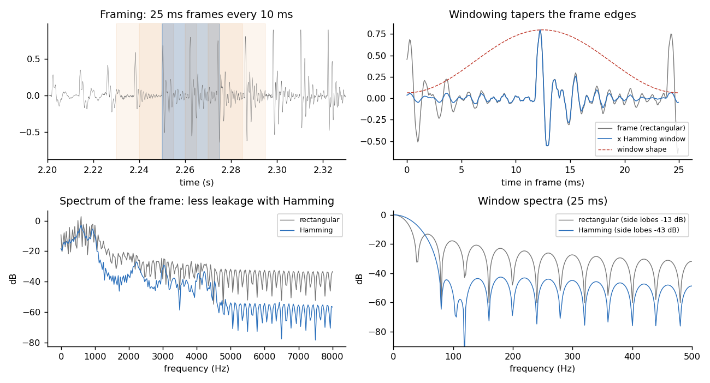
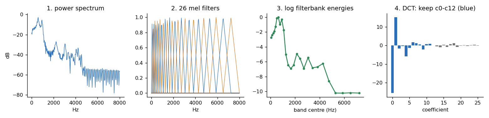
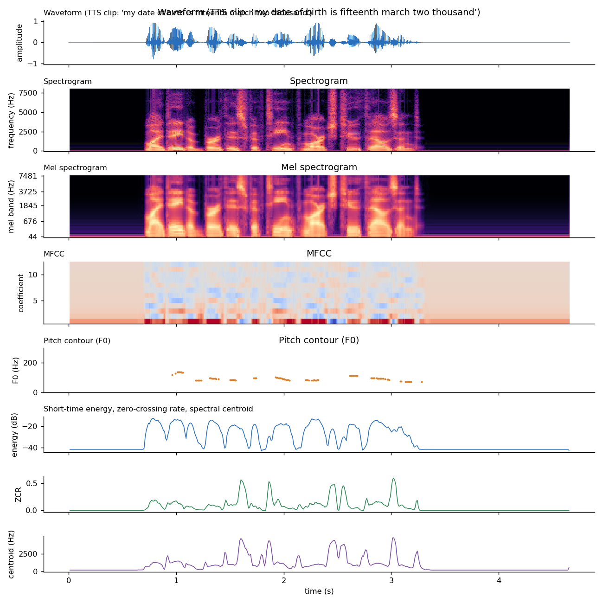
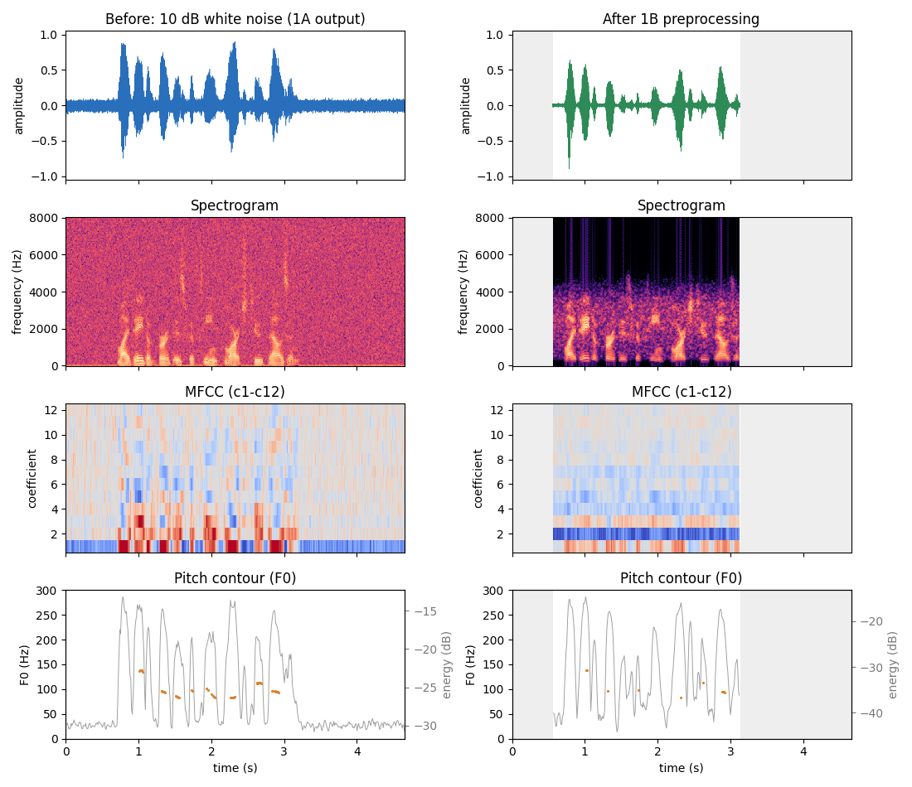
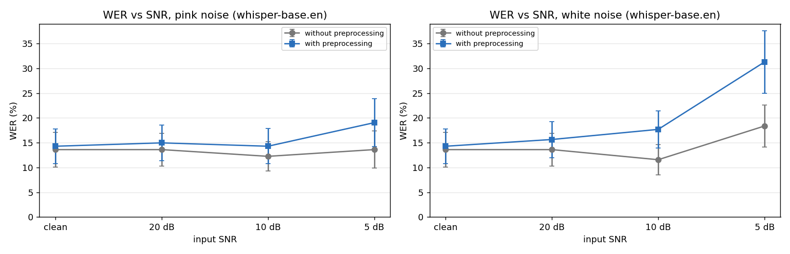

# 1. What 1C is and what it promises

1C turns a recording into numbers and pictures. It also measures whether 1B's preprocessing actually helps the speech recogniser.

```
1A load_audio ──► 1B clean_audio ──► 1C extract_features ──► plots (Signal Lab)
      │                                                     ▲
      └──── before ──────────────────────────────────────────┘
evaluate.py: clips + noise (20/10/5 dB) ──► ASR raw vs ASR preprocessed ──► WER vs SNR
```

> **`feats = extract_features(audio)`** → dictionary of NumPy arrays: short-time energy, ZCR, spectral centroid, pitch (F0), mel spectrogram, 13 MFCCs with Δ and ΔΔ. Every feature is on **one frame grid** (25 ms frames, 10 ms hop), so all arrays line up with `feats["times"]`.

| Item | Value |
|---|---|
| Module files | `features.py` (feature extraction), `plots.py` (figures), `evaluate.py` (WER experiment) |
| Depends on | `audio_io.py` (1A) and `preprocess.py` (1B), NumPy, SciPy, Matplotlib. Optional: `openai-whisper` (ASR backend and English text normaliser) |
| Main functions | `extract_features`, `summarize_features`, `plot_before_after`, `plot_feature_overview`, `plot_wer_vs_snr`, `add_noise`, `word_errors`, `run_experiment` |
| Tests | 93 new tests (`tests/test_features.py`, `test_plots.py`, `test_evaluate.py`), all passing; 215 in total with 1A and 1B |
| Speed | ≈ 52 ms for a 4.7 s clip (1 % of real time) |
| Command line | `python evaluate.py --clips <folder> --model small` |

All features are **implemented directly from their formulas**, not taken from librosa, so every step can be explained in the viva. The tests then check them against librosa with identical settings: the mel filterbank matches to 10⁻⁶, the MFCCs to 10⁻³ and the spectral centroid to 0.01 %.

# 2. Framing and windowing (viva question 1)

**Why frames?** Speech is not stationary: the vocal tract keeps moving. Over about 20–30 ms it hardly changes, though, so a short piece can be treated as stationary and analysed with a Fourier transform. The signal is cut into **25 ms frames (400 samples) every 10 ms (160 samples)**. The 60 % overlap means no event falls between two frames, and 10 ms gives 100 feature vectors per second.

**Why a window?** Cutting a frame out of the signal is the same as multiplying it by a rectangle. The rectangle's spectrum has large side lobes (−13 dB), so the abrupt edges smear energy over all frequencies (**spectral leakage**). Each frame is therefore multiplied by a **Hamming window**:

  `w[n] = 0.54 − 0.46 · cos(2πn / (N − 1))`,  n = 0 … N−1

It tapers the frame to 0.08 at the edges. Its side lobes are at −43 dB, at the price of a main lobe twice as wide, i.e. slightly coarser frequency resolution. The frame is zero-padded to a 512-point FFT (32 ms).

* **Time-domain features** (energy, ZCR) use the plain frame: they describe the waveform itself, and the window would only scale them.
* **Frame grid:** frame *i* covers samples `[160 i, 160 i + 400)` and is centred at `(160 i + 200) / 16000` s. This is exactly the grid of 1B's VAD (`frame_energy_db`), and a test checks that the energies are identical.



# 3. The features

| Feature | Formula | What it shows |
|---|---|---|
| **Short-time energy** | `E = (1/N) Σ x[n]²` per frame (also in dB) | Loudness. Speech ≫ pauses; the basis of 1B's VAD |
| **Zero-crossing rate** | fraction of neighbouring samples with different sign | Voiced sounds (vowels) ≈ 0.05; fricatives (s, sh) and hiss ≈ 0.3–0.5. A pure tone of *f* Hz gives 2f/sr (tested) |
| **Spectral centroid** | `Σ f·|X(f)| / Σ |X(f)|` | "Brightness": where the spectrum's centre of mass is (tested on tones: 500/1500/3000 Hz) |
| **Mel spectrogram** | power spectrum × 40 triangular mel filters | Energy on a perceptual frequency scale (display) |
| **MFCC (13) + Δ + ΔΔ** | see §4 | Spectral envelope = vocal-tract shape; the standard ASR feature |
| **Pitch F0** | YIN, see §5 | Intonation and speaker voice; `NaN` where unvoiced |

# 4. How MFCCs are computed (viva question 2)

1. **Pre-emphasis** `y[n] = x[n] − 0.97 x[n−1]`. 1B has already applied it to the cleaned signal; `extract_features(x, pre_emphasis=0.97)` adds it for raw audio.
2. **Framing + Hamming window** (§2).
3. **FFT → power spectrum** `P(k) = |X(k)|² / 512`, k = 0 … 256.
4. **Mel filterbank.** 26 triangular filters whose edges are equally spaced on the **mel scale**, `mel = 2595 · log10(1 + f / 700)`. Below about 1 kHz this is nearly linear and above it nearly logarithmic, like the ear's frequency resolution. Filter *m* rises from 0 at edge *m* to 1 at edge *m+1* and falls back to 0 at edge *m+2*, so filters are narrow at low frequencies and wide at high ones. Output: 26 band energies per frame.
5. **Logarithm.** Loudness is perceived roughly logarithmically, and the log turns a gain (microphone level) into an additive offset that ends up almost entirely in c0.
6. **DCT-II** (orthonormal) of the 26 log energies; **keep c0–c12**. Neighbouring filter energies are strongly correlated, and the DCT decorrelates them. The low coefficients describe the smooth spectral envelope (formants, i.e. the vocal-tract shape). The high ones describe fine ripple, mostly pitch harmonics, which carry no phoneme identity. c0 is the overall log energy: a test checks that a gain of 0.1 shifts c0 by exactly √26 · ln 100 and leaves c1–c12 unchanged.
7. **Δ and ΔΔ:** regression slope over ±2 frames, `d_t = Σ n (c_{t+n} − c_{t−n}) / (2 Σ n²)`, applied twice. They describe how the spectrum moves (transitions between sounds).



# 5. Pitch (F0) with YIN

YIN (de Cheveigné & Kawahara, 2002), on a **40 ms** window so that two periods of the lowest pitch (60 Hz) fit. The window is centred on the same frame centres as the other features.

1. **Difference function** `d(τ) = Σ (x_j − x_{j+τ})²`: small when the signal repeats after τ samples. It is computed for all frames at once with FFTs, as `d = E₀ + E_τ − 2 r(τ)`.
2. **Cumulative mean normalisation** `d'(τ) = d(τ) · τ / Σ_{k≤τ} d(k)`. This removes the trivial minimum at τ = 0 and makes the value an aperiodicity measure (0 = perfectly periodic).
3. **Absolute threshold:** take the first τ between sr/500 and sr/60 where `d'` < 0.15, and follow it down to its local minimum. Taking the *first* dip rather than the deepest avoids octave errors.
4. **Parabolic interpolation** around τ for sub-sample accuracy: `F0 = sr / τ`.
5. **Voicing:** the threshold must be met, the frame may not be more than 40 dB below the loudest frame, and it may not be digital silence (< −80 dB).

Measured: harmonic tones from 80 to 450 Hz are found within 1 %; the 110 → 140 Hz glide of the synthetic speech is tracked with a median error under 3 %; white noise and silence give no pitch.

**Missing fundamental.** 1B's 300 Hz high-pass removes the fundamental of a typical adult voice (85–250 Hz). YIN still finds the pitch, because it measures the *period* of the waveform and the harmonics repeat with the same period (tested). For low voices, though, fewer frames pass the voicing threshold after 1B. A looser threshold was tried and rejected: it made far more octave errors (5 % → 17–43 % gross errors on the 24 test clips). **For pitch analysis, use the 1A signal (the "before" column)**; the app says so under the figure.



# 6. Before/after plots (Signal Lab)

`plot_before_after(clean_audio_with_stages(x))` draws 4 rows (waveform, spectrogram, MFCC heat-map, pitch contour with the energy curve) × 2 columns (before / after 1B).

* **Same time axis.** The trimmed output is drawn at its original position (shifted by the VAD trim start), and the trimmed parts are greyed out.
* **Same colour scale for both spectrograms** (taken from the input), so "darker" really means "less energy".
* **MFCC maps each use their own symmetric scale.** Pre-emphasis and the band-pass shift the mean of c1–c6 so much that a shared scale would saturate one column. c0 is hidden because its large range would wash out c1–c12.



What preprocessing does to the features (24 stand-in clips, white noise, `docs/results_1c_features.csv`):

| SNR | Centroid before → after (Hz) | ZCR before → after | Energy range before → after (dB) | Voiced frames before → after | F0 within 10 % of clean (after) |
|---|---|---|---|---|---|
| clean | 819 → 1652 | 0.06 → 0.21 | 24.5 → 77.0 | 30 % → 27 % | 95 % |
| 20 dB | 2903 → 1878 | 0.25 → 0.23 | 21.1 → 28.9 | 27 % → 26 % | 95 % |
| 10 dB | 3387 → 1971 | 0.38 → 0.25 | 13.6 → 19.7 | 19 % → 17 % | 95 % |
| 5 dB | 3598 → 2046 | 0.42 → 0.26 | 9.2 → 15.0 | 4 % → 8 % | 92 % |

Before preprocessing, the centroid and ZCR mostly measure the noise: as the SNR falls they climb towards the values of white noise. After 1B they stay nearly constant from clean down to 5 dB. The speech/pause contrast (energy range) is larger after 1B at every SNR. On clean audio the centroid and ZCR *rise* after 1B, because pre-emphasis and the band-pass remove the strong low-frequency energy.

# 7. The evaluation experiment (`evaluate.py`)

**Question:** does 1B make the recogniser more accurate on noisy speech?

1. Load each clip with 1A (`load_audio`).
2. **Add noise** (`add_noise`) at **20, 10 and 5 dB SNR**, white or pink. The SNR is measured against the power of the *speech* (frames found by 1B's VAD on the clean clip), not the whole file: otherwise the pauses would lower the signal power and the real SNR during the words would be better than claimed. Each clip gets its own noise sample, and the same sample is used for both conditions. The measured SNR of the mix is within 0.2 dB of the target (tested).
3. **Transcribe twice:** *raw* (1A only) and *preprocessed* (`clean_audio`). The recogniser is Member 2's `asr_agent.transcribe` when that module exists, otherwise a local Whisper model with greedy decoding (repeatable).
4. **WER** = (S + D + I) / N from a word-level Levenshtein alignment (own implementation, checked against `jiwer` on 300 random pairs). The corpus WER is total errors / total reference words.

**Text normalisation matters for form answers.** Whisper writes "I am 25 years old." for the spoken "twenty five". Compared word for word, that perfect transcript would score 40 % WER. Both texts therefore go through Whisper's `EnglishTextNormalizer` (the one used for the Whisper paper's WER figures: "twenty five" → 25, "fifteenth" → 15th, "nineteen eighty" → 1980), and neighbouring digit groups are joined ("98472 16530" → 9847216530). For Hindi, Malayalam and Kannada only punctuation is removed and case is folded (the English normaliser would strip their vowel signs).

```powershell
python scripts/make_tts_clips.py            # stand-in clips (until 1A's recordings exist)
python evaluate.py --clips data/test_clips_tts --model base.en --noise white pink
python evaluate.py --clips data/test_clips --model small     # the real experiment
python evaluate.py ... --set pre_emphasis=none --set low_hz=80 --set high_hz=7600   # 1B tuning
```

Outputs: `per_clip.csv` (every transcript and its S/D/I), `summary.csv`, `wer_vs_snr.png`, and a Markdown table for the README.

## Results (stand-in clips; Whisper base.en)

**Data:** 24 English form answers (names, ages, dates, phone numbers, addresses) spoken by the three Windows TTS voices (`scripts/make_tts_clips.py`), 147 reference words. **These are not real recordings.** The real 20–30 multilingual clips from 1A must replace them (`data/test_clips/` + `references.csv`) before the results go in the report.

| SNR | White: no preprocessing | White: with preprocessing | Pink: no preprocessing | Pink: with preprocessing |
|---|---|---|---|---|
| Clean | 13.6 % | 14.3 % | 13.6 % | 14.3 % |
| 20 dB | 13.6 % | 15.6 % | 13.6 % | 15.0 % |
| 10 dB | 11.6 % | 17.7 % | 12.2 % | 14.3 % |
| 5 dB | 18.4 % | 31.3 % | 13.6 % | 19.0 % |



**Finding: with Whisper, the 1B chain makes recognition worse, not better**, and the gap grows as noise increases (5 dB white: 18 % → 31 %; error bars are standard errors over clips). Most errors on clean audio are Indian names and places ("Lakshmina Rannan", "Mizzore"), which the English-only model does not know.

**Ablation** (which stage causes it? white noise, `--set` overrides, `docs/results_1c_ablation.csv`):

| Preprocessed variant | 10 dB | 5 dB |
|---|---|---|
| raw (no preprocessing) | 11.6 % | 18.4 % |
| full 1B chain (defaults) | 17.7 % | 31.3 % |
| without pre-emphasis | 19.7 % | 25.2 % |
| without band-pass | 17.7 % | 32.0 % |
| without noise reduction | 26.5 % | 40.8 % |
| wide band 80–7600 Hz, no pre-emphasis | 12.9 % | 19.7 % |
| `noisereduce` instead of spectral subtraction, no pre-emphasis, no band-pass | 18.4 % | 23.8 % |
| VAD trimming only | 13.6 % | 18.4 % |

* **Pre-emphasis hurts most:** it boosts exactly the high-frequency band where white noise lives, and Whisper's log-mel input then sees louder noise.
* **The telephone band (300–3400 Hz) costs accuracy:** Whisper was trained on full-band 16 kHz audio and uses the information above 3.4 kHz (fricatives).
* **Spectral subtraction does help, given the other stages:** removing it makes the chain much worse.
* **No variant beats the raw audio.** This is consistent with what is known about Whisper, which was trained on 680 000 hours of unprocessed, often noisy audio and is robust to noise by itself.

**Recommendation for the team:** send the **1A output (or 1A + VAD trimming)** to Whisper, and keep the 1B chain for the Signal Lab, the features and the VAD. If a cloud ASR is used as the primary recogniser, repeat this experiment with it (`--asr asr_agent`), because other models may react differently. These conclusions must be confirmed on the real recordings.

# 8. Testing

| File | Tests | What is checked |
|---|---|---|
| `tests/test_features.py` | 49 | frame grid = 1B VAD grid; Hamming formula and leakage reduction; energy/ZCR exact values; centroid of tones; mel scale and filterbank shape; MFCC = DCT of log-mel; c0 gain property; Δ of a ramp; **librosa agreement** (filterbank, MFCC, centroid, YIN); pitch of tones 80–450 Hz, glide tracking, missing fundamental, noise/silence unvoiced; input types; config validation; speed |
| `tests/test_plots.py` | 9 | before/after layout; shared time axis and trim offset; shared spectrogram scale; every panel function; WER plot data and labels |
| `tests/test_evaluate.py` | 35 | WER counts (S/D/I), WER > 1, empty references; **jiwer agreement**; English number normalisation; Indic text untouched; SNR accuracy (white/pink, 0–20 dB); SNR measured on speech; pink spectrum slope; deterministic noise; experiment loop and summary with a fake recogniser; CSV/plot output; missing files; **real Whisper tiny.en** on one clip (skipped if the model is not cached) |

`scripts/e2e_check.py` now also runs 1C (feature summary before/after, 5 contract checks, `signal_lab.png`). `scripts/try_it_app.py` has a 1C Signal Lab section (tested headless with Streamlit's `AppTest`).

# 9. Design decisions and viva answers

* **Why one frame grid for everything?** Features can be compared frame by frame (e.g. pitch against energy) and plotted on one time axis, and the energy is identical to the one the VAD used.
* **Why 26 filters for MFCC but 40 for the mel spectrogram?** 26 is the classic HTK/ETSI value for MFCCs (13 coefficients keep the envelope). 40 bands give a smoother picture for display.
* **Why YIN and not autocorrelation?** Plain autocorrelation peaks at multiples of the period too and often halves the pitch. YIN's normalised difference function plus the "first dip below threshold" rule avoids most octave errors, and its value doubles as a voicing confidence.
* **Why is the SNR measured on speech frames?** A 3 s clip with 1 s of speech would otherwise get noise 5 dB too weak for a "10 dB" label.
* **Why normalise numbers before WER?** In this application, digits vs words is a formatting choice, not a recognition error. The field extractor (Member 2) turns both into the same value.

# 10. Known limitations

* The WER numbers come from **TTS stand-in clips** (clean, regular speech) and synthetic noise, not from real recordings in all four languages.
* Pitch after 1B is reported for fewer frames for low voices (missing fundamental, see §5).
* Only white and pink noise are tested; babble and music (common at service counters) are not.
* One noise realisation per clip by default (`--seeds` adds more).

# 11. Files added by 1C

| File | Purpose |
|---|---|
| `features.py` | Feature extraction (`extract_features`) |
| `plots.py` | Signal Lab and analytics figures |
| `evaluate.py` | Noise-robustness experiment (WER vs SNR) |
| `scripts/make_tts_clips.py` | Stand-in evaluation clips (Windows TTS) |
| `scripts/demo_features.py` | Figures 9–12 and `docs/results_1c_features.csv` |
| `data/test_clips_tts/` | 24 stand-in clips + `references.csv` |
| `docs/results_1c_wer.csv`, `docs/results_1c_ablation.csv` | Measured WER results |
| `tests/test_features.py`, `test_plots.py`, `test_evaluate.py` | Tests |
