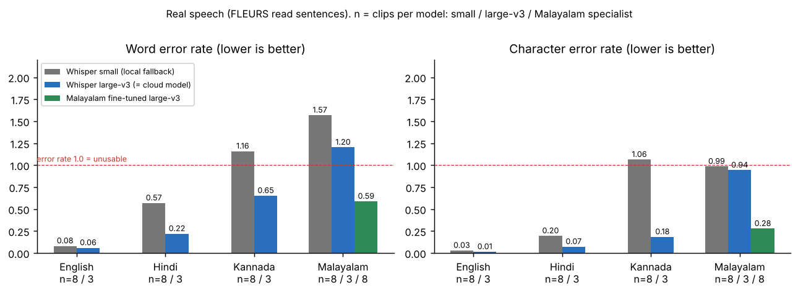

# 1. What 2A is and what it promises

2A turns the cleaned audio from Member 1 into text and says which language was spoken.

> **`text, language = transcribe(audio)`** → `text` is a Unicode string; `language` is `"ml"`, `"kn"`, `"hi"`, `"en"` or `"unknown"`.

`audio` can be the array returned by 1B's `clean_audio` (16 kHz, mono) or anything 1A accepts (file path, bytes, upload, `(signal, sr)`). The richer call `transcribe_full(audio)` returns a `TranscriptionResult` with everything the dialogue (3A) and the session log (3B) need:

| Field | Meaning |
|---|---|
| `text`, `language` | the answer (the same two values as the tuple) |
| `engine`, `model` | which engine produced it (`cloud` / `local`) and which model |
| `fallback_used`, `fallback_reason` | the cloud was wanted but the local engine answered, and why |
| `language_confidence`, `language_probs` | language-ID confidence over the four languages (local engine) |
| `reliable` | **`False` means "ask the user to confirm or repeat"**; the reasons are in `warnings` |
| `warnings` | plain-language notes ("text is in Latin letters", "local model unreliable for Malayalam", …) |
| `latency_s`, `audio_seconds`, `segments` | timing and per-segment confidence (`avg_logprob`, `no_speech_prob`) |
| `skipped` | set when no engine was called (silence / too short) |

| Item | Value |
|---|---|
| Module | `stt.py` (depends on `audio_io.py` from 1A; `preprocess.py` from 1B only if `preprocess=True`) |
| Tests | 100 automated tests (`tests/test_stt.py`) + 2 real-model tests; **222 tests in the whole project, all passing** |
| Command line | `python stt.py clip.wav`, `python stt.py --status`, `python stt.py --download` |

# 2. The most important finding (read this first)

I measured both engines' model families on **real human speech** in all four languages (Section 5). The result changes how the project should be planned:

* **English and Hindi work well** with Whisper.
* **Kannada** is usable only with a large model (cloud-class): the character error rate is 0.18 with `large-v3`, but the local `small` model fails (error rate above 1.0).
* **Malayalam does not work with stock Whisper at any size.** Stock `small` and stock `large-v3` produce text in the wrong writing system (Telugu, Devanagari, Gurmukhi or English letters). A **Malayalam fine-tuned Whisper** model (`rontroy/whisper-large-v3-malayalam-ct2`) gave correct Malayalam script in 8 of 8 clips, with a word error rate of 0.59 and a character error rate of 0.28.
* Because of this, 2A supports **per-language specialist models** (Section 4.6), and I recommend **letting the user pick the language in the UI** instead of relying on automatic language ID (Section 8).

{width=17cm}

# 3. Everything that was used

## 3.1 Software

| Component | Version | Role in 2A |
|---|---|---|
| Python | 3.13 | Language |
| **faster-whisper** | 1.2.1 | Local engine: runs Whisper through CTranslate2 (about 4× faster than the original implementation, and supports int8 quantisation for CPUs) |
| **CTranslate2** | 4.9.0 | The inference engine under faster-whisper |
| **requests** | 2.34.2 | Cloud engine HTTP client (multipart upload, time-outs) |
| NumPy, SoundFile | 2.5.3 / 0.14.0 | Audio arrays; WAV encoding for upload |
| `audio_io.py`, `preprocess.py` | 1A, 1B | Input handling; optional cleaning with `preprocess=True` |
| python-dotenv (optional) | — | Reads API keys from a `.env` file |
| pytest | 9.2.0 | Tests |
| pyarrow, huggingface_hub | — | Only for downloading the test speech (`scripts/fetch_fleurs_samples.py`) |

## 3.2 Models and services

| Name | Used as | Notes |
|---|---|---|
| Whisper **small** (`Systran/faster-whisper-small`, 244 M parameters, about 460 MB) | Local fallback (as specified) | Downloaded once; then works offline |
| Whisper **large-v3** (`Systran/faster-whisper-large-v3`, 1.55 B parameters, about 3 GB) | Stand-in for the cloud model in my tests | Same model as Groq's `whisper-large-v3`, but run locally |
| `rontroy/whisper-large-v3-malayalam-ct2` (Apache-2.0 per its model card) | Optional Malayalam specialist | About 3 GB. Verify its licence and intended use yourself before relying on it |
| **Groq** `whisper-large-v3` or **OpenAI** `whisper-1` | The cloud engine | Any OpenAI-compatible `/audio/transcriptions` endpoint works; chosen by environment variables |

## 3.3 Dataset

2A does not train anything, so there is no training set. For evaluation I used **real recorded speech**:

* **Google FLEURS** (licence CC-BY 4.0), read from Hugging Face's Parquet copy of the *test* split.
* **8 clips per language** (Malayalam, Kannada, Hindi, English), **32 in total**, chosen to alternate male and female speakers, each 4–15 seconds long.
* Each clip is a person reading a sentence taken from Wikipedia-style text (news, geography, science). The reference transcripts come from FLEURS (lower-cased, without punctuation). Scores are computed after the same normalisation of the output.
* The clips are **not** stored in the project (they are large). `scripts/fetch_fleurs_samples.py` downloads the same kind of set; expect about 300–900 MB of download per language, once.

*Honest limits of this evaluation:* (a) FLEURS sentences are long read text, **not form answers** (a name, an age, a phone number, an address), which are shorter but contain names and digits that Whisper handles differently; (b) only 8 clips per language (3 for `large-v3`), so the numbers show clear differences but have wide error bars; (c) the **cloud engine itself could not be tested against the real API** from my environment (see Section 6).

# 4. How it works

## 4.1 The flow of one answer

```
audio ─► prepare ─► silence / too short?  ─► yes: return "" + "please repeat" (no engine is called)
                          │ no
                          ▼
      language hint given?  ─► (hint for a specialist language: local first)
                          ▼
   CLOUD engine (Groq / OpenAI)  ──fails / no key / breaker open──►  LOCAL engine (Whisper small)
        │ language outside the four? → retry as the nearest of the four
        │ detected language has a specialist model? → re-transcribe with the specialist
                          ▼
   safeguards: Unicode clean-up, repetition-loop filter, script check, reliability flags
                          ▼
                 (text, language) + TranscriptionResult
```

## 4.2 How Whisper works (viva)

Whisper is an **encoder-decoder Transformer** trained on hundreds of thousands of hours of multilingual, weakly-labelled web audio.

1. **Input features.** The 16 kHz audio is padded or cut to 30 s and converted to a **log-Mel spectrogram** (80 Mel bands, 128 for large-v3; 25 ms windows, 10 ms steps), giving 3000 frames. (This is the same spectral analysis as in 1C's MFCC/Mel work.)
2. **Encoder.** Two 1-D convolution layers (the second halves the time resolution) followed by a stack of Transformer self-attention blocks. Output: 1500 vectors that summarise the sound.
3. **Decoder.** A Transformer decoder generates **text tokens one at a time** (byte-pair encoding), attending to the encoder output through **cross-attention**, and to its own previous tokens.
4. **One model, many tasks.** The decoder is started with special tokens: `<|startoftranscript|>`, a **language token**, `<|transcribe|>` (or `<|translate|>`), and `<|notimestamps|>`. Changing these tokens changes the task.
5. **Why it is weak in some languages.** Whisper learned from web data: English dominates, and languages such as Malayalam have very little training audio. Our measurements show the consequences.

## 4.3 Language identification (viva)

Language ID comes from the decoder itself: after `<|startoftranscript|>` the model predicts the **language token**, a probability over about 99 languages. `faster-whisper` exposes these probabilities.

Two refinements are added in 2A:

* **Restriction to the four project languages.** The probabilities for the four languages are kept and **renormalised** to sum to 1. This removes errors such as Telugu or Tamil winning over Kannada or Malayalam. The share of probability that was on the four languages (`supported_mass`) is kept; a small value warns that the speech is probably in some other language.
* **Script cross-check.** Malayalam, Kannada and Hindi (Devanagari) each have their own writing system. If the language label disagrees with the script of the text, the result is flagged (and a language label that contradicts a non-Latin script is corrected). This also catches the "Whisper translated into English" failure.

*Measured:* restricted language ID with `small` was 100 % correct for English and Hindi but only 62 % for Kannada and 75 % for Malayalam (it mistook Kannada for Hindi). With `large-v3` it was 100 % for Kannada, 67 % for Malayalam (3 clips each). So **automatic language ID is not reliable for Malayalam and Kannada; let the user choose the language** (a `language=` hint skips detection).

## 4.4 The cloud engine

* A plain HTTP `POST {base_url}/audio/transcriptions` with `multipart/form-data`: `file` (16-bit WAV), `model`, `response_format=verbose_json`, `temperature=0`, and optionally `language` (an ISO code) and `prompt`. The API key goes only in the `Authorization: Bearer` header.
* The `verbose_json` answer gives the text, the detected language and per-segment confidence (`avg_logprob`, `no_speech_prob`). The language may arrive as a name ("malayalam") or a code; both are understood.
* **Errors:** time-out, network error, HTTP 429 and 5xx are retried once (with back-off); HTTP 401/403 (bad key) and 400 are not retried; unreadable answers raise an error. Error messages never contain the API key; the key is not written to logs.
* **Safety:** a non-`https` base URL is refused (except `localhost`) so the key cannot be sent in clear text. Uploads are limited to 24 MB (providers allow about 25 MB).
* **Which provider:** `GROQ_API_KEY` selects Groq (`whisper-large-v3`); otherwise `OPENAI_API_KEY` selects OpenAI (`whisper-1`); `SVARA_STT_BASE_URL` + `SVARA_STT_API_KEY` select any other compatible service.

## 4.5 The local engine and automatic failover

* `faster-whisper` loads Whisper `small` on first use (int8 on CPU, float16 on GPU) and keeps it in memory; `python stt.py --download` fetches the model once so that later runs are fully offline. The model is loaded only once and calls are serialised with a lock.
* **Failover (`engine="auto"`):** cloud first; the local engine answers if there is no API key, the network is down, the request times out, or the cloud returns an error.
* **Circuit breaker:** after 2 consecutive cloud failures the cloud is skipped for 60 seconds. Without this, an offline demo would wait for a network time-out on *every* answer. A missing API key never trips the breaker.
* `engine="cloud"` or `engine="local"` forces one engine (no silent fallback).
* **Speed setting:** Whisper normally retries a doubtful decode several times at higher randomness. For short form answers this rarely helps and is very slow, so it is **off by default** (`local_temperature_fallback=False`). Measured with `small`: Malayalam clips averaged 6 s instead of 23 s and Kannada 9 s instead of 27 s on a 4-core CPU; the worst clip fell from more than 60 s to about 11 s.

## 4.6 Specialist models per language

`STTConfig(specialists={"ml": "rontroy/whisper-large-v3-malayalam-ct2"})` (or the environment variable `SVARA_WHISPER_MODEL_ML`) tells the local engine to use that model for that language. Routing:

* **Language known** (the user picked it): the specialist is used directly, **before** the cloud.
* **Language detected**: the default model identifies the language; if a specialist exists, the audio is transcribed again with it. If the cloud engine detected Malayalam, its transcript is replaced by the specialist's.
* If the specialist cannot be loaded, the cloud result is kept and flagged as unreliable.

It is **opt-in** because the model is about 3 GB and slow on a CPU (20–39 s per 10 s clip in my test, much faster on a GPU).

## 4.7 Safeguards

| Problem | What 2A does |
|---|---|
| Silence or very short clip (Whisper invents text on silence) | Never sent to an engine; returns `""`, `reliable=False`, "please repeat" |
| A repeating loop ("thank you thank you …") | Discarded, flagged |
| Text in the wrong writing system, or English where Indic text was asked for | Flagged `reliable=False` with the reason |
| Local `tiny`/`base`/`small` model used for Malayalam or Kannada | Warning: unreliable; confirm with the user (a specialist or larger model is not flagged) |
| Unsupported language detected (e.g. Tamil, Telugu, Urdu) | Re-run as the nearest supported language (Tamil→Malayalam, Telugu→Kannada, Urdu→Hindi, …) or English |
| Unicode variants of the same letters | Text is normalised to NFC; whitespace collapsed |
| Low language confidence (below 0.6) | Flagged |

# 5. Results (real speech)

Each cell is the mean over the clips of that language. **WER** = word error rate = (substitutions + deletions + insertions) / number of reference words. **CER** is the same at the character level. They can exceed 1.0 when the output is much longer than the reference or is garbage. Indic WER is pessimistic (spelling variants, joined/split words, digits vs words), so compare the models with each other rather than with English.

| Language | Model | Clips | Language ID correct | Mean WER | Mean CER | Output in the right script |
|---|---|---|---|---|---|---|
| English | small | 8 | 100 % | 0.08 | 0.03 | yes |
| English | large-v3 | 3 | 100 % | 0.06 | 0.01 | yes |
| Hindi | small | 8 | 100 % | 0.57 | 0.20 | 8/8 |
| Hindi | large-v3 | 3 | 100 % | 0.22 | 0.07 | yes |
| Kannada | small | 8 | **62 %** | **1.16** | **1.06** | 3/8 (forced run) |
| Kannada | large-v3 | 3 | 100 % | 0.65 | 0.18 | 3/3 |
| Malayalam | small | 8 | **75 %** | **1.57** | **0.99** | **0/8** (forced run) |
| Malayalam | large-v3 | 3 | **67 %** | **1.20** | **0.94** | **0/3** |
| Malayalam | **fine-tuned large-v3** | 8 | (language given) | **0.59** | **0.28** | **8/8** |

*Sample output (Malayalam, fine-tuned model, clip 1):* reference "ഈ നഗരം രാജ്യത്തെ മറ്റ് നഗരങ്ങളിൽ നിന്ന് പൂർണ്ണമായും വ്യത്യസ്തമാണ്…", output "ഈ നഗരം രാജ്യത്തെ മറ്റ് നഗരങ്ങളിൽ നിന്ന് പൂർണ്ണമായും വ്യത്യസ്തമാണ്, കാരണം…" (WER 0.14).

*Language-ID confusions of `small` in automatic mode (true → detected):* Kannada→Hindi ×3, Malayalam→Kannada ×1, Malayalam→Hindi ×1; English and Hindi were never confused.

*Latency* (4-core CPU, no GPU): `small` 2–3 s per clip for English, about 9 s for Hindi, 6–9 s for Malayalam/Kannada with the default speed setting; `large-v3` 15–43 s; the Malayalam specialist about 37 s on average (20–39 s) per 10 s clip. A real form answer is only a few seconds long, so these times will be shorter.

Raw per-clip results are in `docs/results_2a_*.csv`.

## 5.1 Preview: does the 1B chain help Whisper? (not the final answer)

Whisper `small`, language given, 8 clips each, mean WER. "Noise" = white noise added at 10 dB SNR.

| Condition | English | Hindi |
|---|---|---|
| clean, raw | 0.085 | 0.543 |
| clean, full 1B chain | 0.084 | 0.733 |
| 10 dB noise, raw | 0.092 | 0.653 |
| 10 dB noise, full 1B chain | 0.155 | 0.787 |
| 10 dB noise, noise-reduction + VAD only | 0.095 | 0.755 |
| 10 dB noise, band-pass only | 0.165 | 0.731 |

In this preview **the full chain did not improve recognition; it made it worse**, and the band-pass (300–3400 Hz) was the main cause. Whisper itself was already very robust to 10 dB white noise (English 0.085 → 0.092). This confirms the warning given with 1B (Whisper is trained on full-band, unprocessed audio, and the band-pass removes the 3.4–8 kHz consonant detail). **Limits:** only 8 clips, one noise type, read speech that has few pauses (so noise reduction cannot estimate the noise well), and 10 dB rather than 5 dB. The real experiment in 1C (20/10/5 dB, several stages on and off, and ideally real room noise) must decide; a sensible next step is a "Whisper-friendly" 1B setting (`bandpass=False, pre_emphasis=None`, keeping noise reduction and VAD) and testing it at 5 dB.

# 6. Testing

## 6.1 Automated (no network, no model; `python -m pytest tests/test_stt.py`)

* **Cloud protocol against a mock server** that imitates the documented API: exact request (path, auth header, fields, 16 kHz WAV), language as name or code, segment parsing, HTTP 401 (not retried), 429 / 5xx (retried), persistent failure, time-out, connection refused, unreadable or wrong-shaped answers, 400 errors (API key removed from the message), oversize audio, http-URL refusal, provider selection from environment variables, API key never in logs.
* **Orchestrator with fake engines:** cloud first; every failure path falls back to local; breaker opens, skips and recovers; a missing key never trips it; both engines failing raises `STTError` with both reasons; forced engines do not fall back; language hints; unsupported-language retries; script correction; the reliability flags; repetition loop; empty text; silence and short clips never reach an engine; input types (path, bytes, `BytesIO`, tuple, array, resampling); `preprocess=True`; module-level functions.
* **Local engine with a fake `faster_whisper` module:** restricted language ID and re-run, single pass when Whisper's best language is supported, hint skips detection, decoding settings, load-once, missing library and load-failure messages, specialist routing.
* **Real model (2 tests; set `SVARA_STT_TESTDATA`)**: real Whisper small on real English and Hindi clips.

## 6.2 The cloud engine against the real API: not done by me

My environment could not reach Groq or OpenAI, so **the real cloud call is untested** here. The code follows the documented OpenAI-compatible protocol (which Groq also implements) and is verified against a mock of it, but you must run one real check yourself:

```powershell
set GROQ_API_KEY=your_key_here
python stt.py --status
python stt.py "D:\path\to\clip.wav" --engine cloud
python scripts/test_stt_languages.py --data stt_testdata --engines local cloud
```

If the first call fails, `python stt.py clip.wav --engine cloud` prints the reason (bad key, no network, HTTP code). I could not confirm from the documentation whether the response's `language` field is a name or a code, so both are accepted; and the 25 MB upload limit comes from secondary sources.

## 6.3 Testing both engines in all four languages (the task from the plan)

`scripts/test_stt_languages.py` runs each engine on every clip in two modes (**auto**: the engine must identify the language; **forced**: the language is given) and prints language-ID accuracy, WER, CER and latency per language, and writes a CSV. I ran it for the local engine with three models (results above); you run the same command with `--engines local cloud` once you have an API key.

# 7. Using it

```python
from stt import transcribe, transcribe_full, detect_language, get_default

text, lang = transcribe(cleaned)                       # the 2A contract
text, lang = transcribe(cleaned, language="ml")        # the user chose Malayalam (recommended)
r = transcribe_full(cleaned, language="kn", prompt="Hospital registration form. Name and address.")
if not r.reliable:                                     # ask the user to confirm or repeat
    print(r.warnings)
text, lang = transcribe("answer.wav", preprocess=True) # run the 1B chain first
code, conf, probs = detect_language(cleaned)           # language ID only (local probabilities)
get_default().warm_up()                                # load the local model at app start
```

**Settings** (environment variables, or a `.env` file; see `.env.example`):

| Variable | Meaning |
|---|---|
| `GROQ_API_KEY` or `OPENAI_API_KEY` | Enables the cloud engine |
| `SVARA_STT_ENGINE` | `auto` (default), `cloud` or `local` |
| `SVARA_STT_MODEL` | Cloud model name (defaults: `whisper-large-v3` for Groq, `whisper-1` for OpenAI) |
| `SVARA_WHISPER_MODEL` / `SVARA_WHISPER_PATH` | Local model name, or a folder with a downloaded model (default `small`) |
| `SVARA_WHISPER_MODEL_ML` (`_KN`, `_HI`, `_EN`) | Specialist model for that language |
| `SVARA_STT_OFFLINE=1` | Never contact the network for the local model |

**Command line:** `python stt.py clip.wav [--engine auto|cloud|local] [--language ml] [--preprocess]`, `python stt.py --status`, `python stt.py --download`.

**Try it with your voice:** `streamlit run scripts/try_it_app.py` now shows the whole chain 1A → 1B → 2A (choose language, engine, and whether the recogniser gets the raw or the cleaned audio).

# 8. Design decisions and recommendations for the team

1. **Let the user choose the language in the UI** (a selector at the start of the dialogue) and pass `language=` for every answer. Automatic language ID was wrong for 25–38 % of Malayalam and Kannada clips with the small model. Use detection only as a hint or a check.
2. **Plan for Malayalam separately.** Stock Whisper (local or cloud) fails. Options: the Malayalam fine-tuned model through `specialists` (tested), or another provider with Malayalam support such as Google Cloud or Azure speech services, or AI4Bharat's Indic models (**I did not test these**). Whichever is chosen, test it with *your own* recordings of form answers.
3. **Cloud first, local fallback** is the right shape for Hindi, English and Kannada: the large cloud model was much better than local `small` (Hindi WER 0.22 vs 0.57; Kannada 0.65 vs 1.16). The local engine is the offline safety net, and honest about its weakness for Malayalam and Kannada.
4. **Use the read-back confirmation** in the dialogue (this is why the design has it): `reliable=False` and the warnings tell you when to insist on it.
5. **Privacy:** the cloud engine uploads the user's voice (names, health details) to a third party. Say so in the demo and offer `engine="local"` as the private mode.
6. **Short prompts help:** `prompt=` (for example "Hospital registration form. Name, age, phone number.") biases Whisper toward the expected words, but can also be echoed on near-silence; test before relying on it.
7. **Re-check the preprocessing recommendation with 1C** (Section 5.1) before the demo claims that preprocessing improves accuracy.

# 9. Viva questions

* *How does Whisper work?* Section 4.2: log-Mel input, convolution + Transformer encoder, autoregressive Transformer decoder with cross-attention, special tokens select task and language.
* *How does language identification work?* Section 4.3: the decoder's first predicted token is a language token; take its probabilities, keep the four languages, renormalise; cross-check with the writing system.
* *How is WER calculated?* (S + D + I) / N from the word-level edit distance; the test harness has the dynamic-programming implementation (`edit_distance`).
* *Why is there a fallback and a circuit breaker?* Network and API failures must not stop the dialogue; the breaker avoids a time-out on every answer when offline.
* *Why is Malayalam hard?* Little training data for the language in Whisper; stock models answer in the wrong script; fine-tuning fixes it (Section 5).
* *Why does the guided dialogue improve accuracy?* Each answer is short and about one known field, the language can be fixed in advance, a prompt can bias the vocabulary, and the read-back confirmation catches errors.
* *Why `temperature=0`?* A deterministic decode is faster and reproducible; the random retry loop rarely helps on short answers.

# 10. Known limitations (stated plainly)

* **Cloud engine not tested against the real API** (Section 6.2).
* **Evaluation is small and not on form answers:** 8 clips per language (3 for `large-v3`), read sentences; confidence intervals are wide.
* **Malayalam needs a specialist model**, which is slow on a CPU and not part of the default install. Its licence and quality on your own speakers must be checked.
* **Kannada with the local `small` model is not usable**; with the large (cloud-class) model it is readable but imperfect (WER 0.65, CER 0.18).
* **Automatic language ID is unreliable for Malayalam and Kannada**; the nearest-language rules for unsupported languages are heuristics.
* **Code-mixed speech** (Hindi-English "Hinglish", Malayalam-English) was not evaluated; Whisper may output a mix of scripts, which the script check flags.
* **Digits and names:** Whisper may write numbers as digits or words; 2B (field extraction) must normalise them.
* The 1B preview is only a preview (Section 5.1).

# 11. Files added by 2A

```
stt.py                                   ← the 2A module (the deliverable)
tests/test_stt.py                        ← 100 tests (+ 2 real-model tests)
scripts/test_stt_languages.py            ← tests both engines in all four languages (WER, CER, language ID)
scripts/fetch_fleurs_samples.py          ← downloads real test speech (FLEURS, CC-BY 4.0)
scripts/plot_stt_results.py              ← makes Figure 9
scripts/try_it_app.py                    ← updated: now includes the 2A transcription panel
docs/2A_Speech_to_Text.(md|docx)         ← this document
docs/results_2a_*.csv, docs/figures/fig9_stt_results.png
.env.example, requirements.txt, .gitignore (updated)
```

Run the checks: `pip install -r requirements.txt` then `python -m pytest`.
